# 旧 ITP 交易管理功能分析（2026-11-18 实扫）

> **范围**：旧 ITP 综管台「运营管理 → 交易管理」下 6 个页面；不含「用户管理 → 订单退款 / 支付信息」与「电子车票业务」下的扣款/闸机交易页。
> **方法**：2026-11-18 15:0x（GMT+8）用内置浏览器登录旧 ITP（`http://58.56.166.170:9080/qd-omp/a/login`，账号 `FuTianTest002`，页面显示「福田测试2」），逐页直接进 `list` URL、展开查询区、读 DOM 与截图；**全程只读，零写操作**（未点「成功 / 失败」等处置按钮，未提交任何表单）。
> **口径**：旧系统仅外网可达、与新综管台网络互斥；本页是**页面/功能层分析**，不是数据一致性核对。旧侧数据为 2026-11-18 快照，随旧系统变化会过期，引用时 MUST 现查。新侧对照基准为 [新旧 ITP 综管台对标报告 §2.3](../新旧ITP综管台对标-2026-11-03.md) 与 `web-server/sql/legacy-txn-menu.sql` 及 6 个新前端页源码。
> **截图与详情证据**：21 张单独截图已落盘至 [screenshots/](legacy-txn-export-2026-11-18/screenshots/)（清单见 [截图说明](legacy-txn-export-2026-11-18/README.md)），覆盖 6 个功能页的列表/查询条件 + 各页详情表单（含滚动到页底）+ 异常类型字典。字段级逐项抄录见 [详情字段全集](legacy-txn-export-2026-11-18/旧ITP交易管理-详情字段全集.md)。全程只读，未点处置按钮、未提交表单。

## 0. 按截图菜单速览（本次用户截图对应 6 项，选中项为「单程票购票订单」）

| 菜单 | 一句话功能 | 数据/操作形态 | 新系统现状与缺口 |
|---|---|---|---|
| BOM 非现金管理 | 查 BOM 站内非现金订单（购票发售/充值同表） | 订单号+卡号+设备+通道+类型/状态+时间；列表带「操作」列 | 新页只读、`TRANS_TYPE=01/22` 拆页；旧「操作」动作未确认 |
| 单程票购票订单 | 查单程票购票订单 | 按交易/商户订单号、**用户标识**、支付渠道订单号、下单/支付渠道、票卡种类、状态、时间查 | 新页只读，用 `cardId` 代替用户标识、渠道合并；旧有「操作」列 |
| TVM 充值订单管理 | 查 TVM 充值订单全量（订单+支付+线路+设备+卡+金额+状态） | 带**导出数据**；行可进订单/支付/操作历史详情 | 新页只读+回执状态；无导出、无详情下钻 |
| TVM 充值存疑订单处理 | 同一订单表中 `orderStatus=2` 的存疑子集处置 | **唯一有人工动作**：行级成功/失败判定；详情含写卡时间/充值金额/余额/支付信息/操作历史 | 新页只读回执（`F2F_RESULT_REPORT`），处置走内部补偿链路，综管台**无处置闭环** |
| 单边查询 | 查扣款请求记录里的单边账（入站/出站/人工处理单） | 3791 条、带**数据导出**、行进详情；异常类型 5 值字典 | 新页只读 `GATE_TXN_PAY`，默认 `1/2`、可 `1~5`；字典映射待确认 |
| 在线补款订单管理 | 查超时补款**应收**单 | 按补款订单号/交易/渠道/商户订单号查；列表带「操作」列 | 新页只读 `SUPPLEMENT_ORDER`；另有反向的退罚金页，旧「操作」语义待确认 |

> **整体判断**：这 6 页本质是「交易记录查询 + 少量异常处置」，读多写少；旧侧把异常处置入口放在订单页上，新侧保留查询、把处置下沉到后端补偿链路。要对齐的**不是补 6 个查询页**，而是先裁定存疑单处置、数据视角与导出/详情能力（见 §4、§5）。

### 截图索引（每张独立文件，点开可看原图）

| 功能 | 列表页 | 查询条件 | 详情/字典 |
|---|---|---|---|
| BOM 非现金管理 |  | 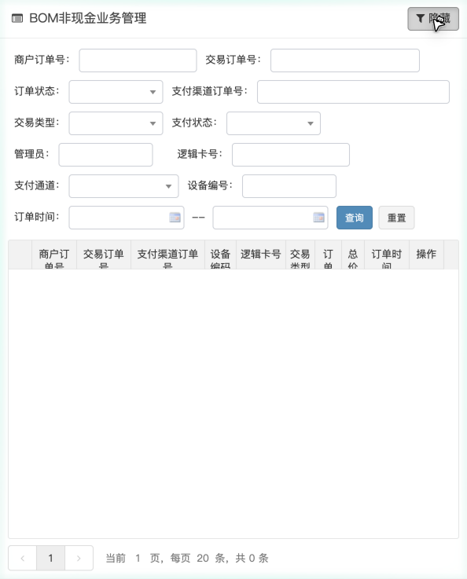 | 0 条，无详情 |
| 单程票购票订单 |  | 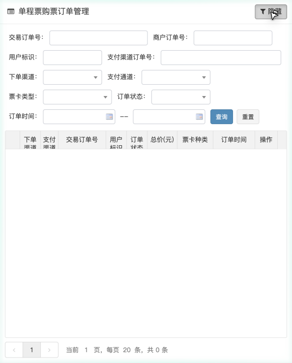 | 0 条，无详情 |
| TVM 充值订单管理 |  | 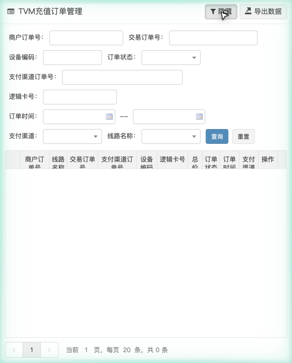 | 见下页详情 |
| TVM 充值存疑订单处理 | 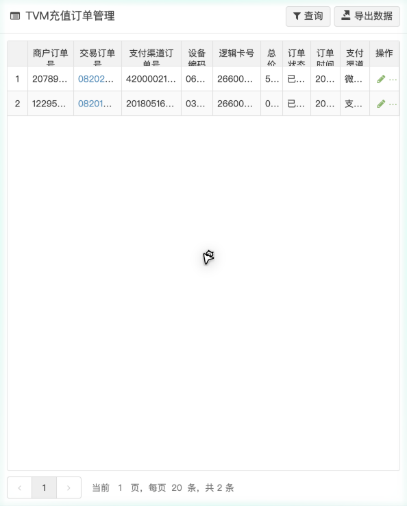 | 同 TVM 列表 | 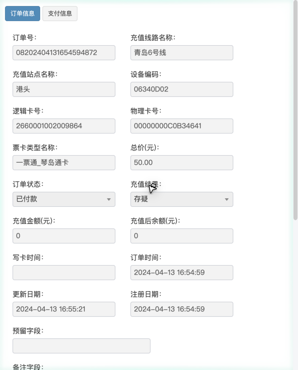 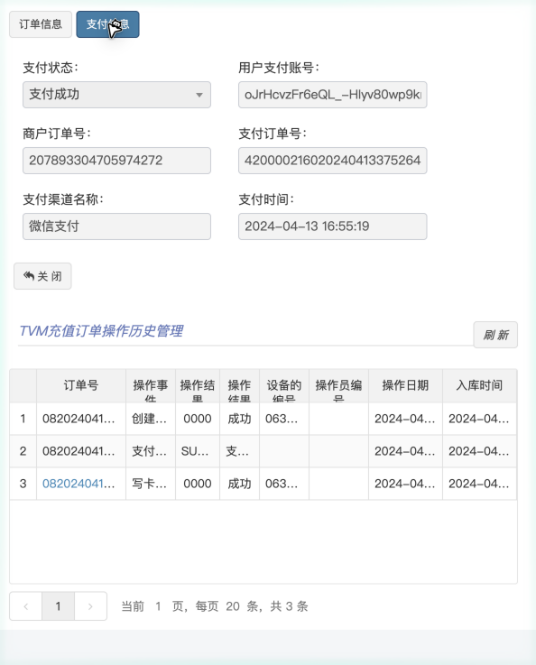 |
| 单边查询 | 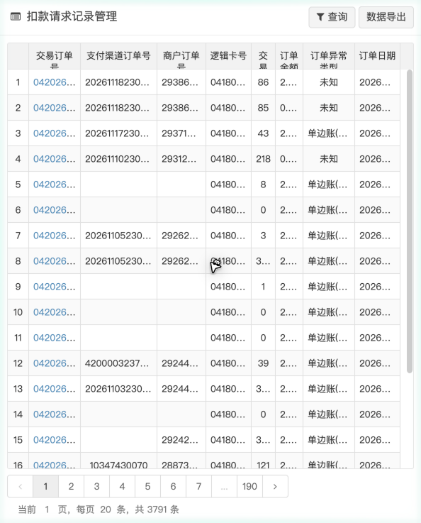 | 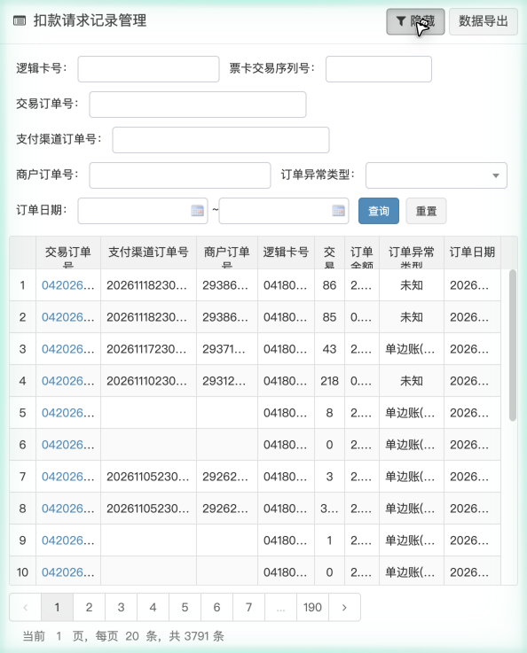 | 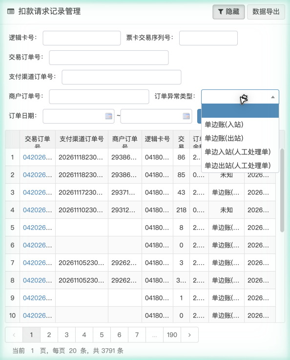 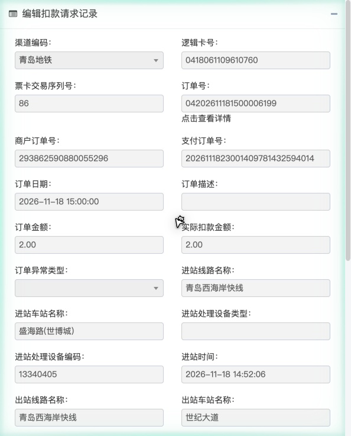 |
| 在线补款订单管理 | 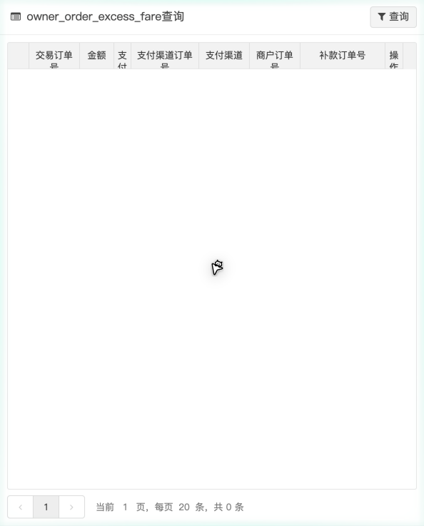 | 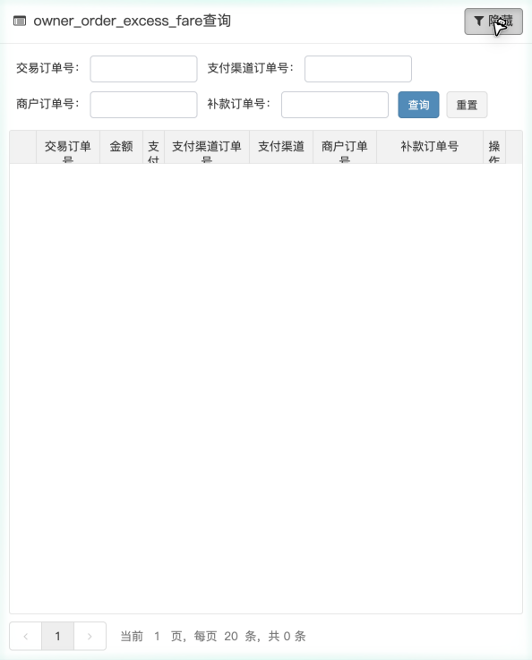 | 0 条；新增态表单字段见 [详情字段全集 §5](legacy-txn-export-2026-11-18/旧ITP交易管理-详情字段全集.md) |

> ⚠️ **补录（2026-11-18 15:24 追加滚动到页底）**：①单边详情页底部有 **「申请退款」写操作按钮**（[截图 16](legacy-txn-export-2026-11-18/screenshots/16-oneside-detail-refund-action.png)），此前 §2.4/§4 只记「行进详情」漏记此动作，新页无对应能力；②单程票详情的「订单操作历史」子表 **425,048 条 / 21,253 页**（[截图 19](legacy-txn-export-2026-11-18/screenshots/19-sjt-detail-form-bottom.png)），远大于主表，迁移/对接按大表处理。字段级全文见 [详情字段全集](legacy-txn-export-2026-11-18/旧ITP交易管理-详情字段全集.md)。

## 1. 六页全景与数据量

| # | 旧菜单 | 旧 URL（`a/` 后段） | 11-03 记录 | 11-18 实扫 total | 页面形态 |
|---|---|---|---|---|---|
| 1 | BOM 非现金管理 | `owner/ownerOrderNoCash/list` | — | **0** | 纯查询，有「操作」列（无数据无法判动作） |
| 2 | 单程票购票订单 | `owner/ownerOrderSjt/list` | — | **0** | 纯查询，有「操作」列 |
| 3 | TVM 充值订单管理 | `owner/ownerOrderTvmTopup/list` | — | **0** | 查询 + **导出数据** + 「操作」列 |
| 4 | TVM 充值存疑订单处理 | `owner/ownerOrderTvmTopup/tvmMng?orderStatus=2` | — | **2** | 与上页同控制器、带 `orderStatus=2` 过滤；行级处置动作 + 详情表单 |
| 5 | 单边查询 | `metro/metroMemberDebitRecord/orderExpTypeList` | 3780 | **3791** | 查询 + **数据导出**；行点进扣款记录详情 |
| 6 | 在线补款订单管理 | `owner/ownerOrderExcessFare/list` | — | **0** | 查询 + 「操作」列；标题未国际化 |

> 第 3、4 页是**同一张订单表的两种视图**：不带过滤的 `list` 为 0 条，带 `orderStatus=2` 的 `tvmMng` 反而有 2 条存疑单（2018-05-17、2024-04-13 的老单）。对标时不能把两页当成两张独立台账。

## 2. 逐页功能拆解

### 2.1 BOM 非现金管理（0 条）

- **查询条件**（DOM `name`）：`panchanTradeNo` 商户订单号、`orderNo` 交易订单号、订单状态（下拉）、`payTradeNo` 支付渠道订单号、交易类型（下拉）、支付状态（下拉）、`managerId` 管理员、`cardId` 逻辑卡号、支付通道（下拉）、`deviceId` 设备编号、`orderDate_gte/lte` 订单时间。
- **列表列**：商户订单号 / 交易订单号 / 支付渠道订单号 / 设备编码 / 逻辑卡号 / 交易类型 / 订单（列头截断，疑为订单状态）/ 总价 / 订单时间 / 操作。
- **观察**：查询维度是「订单号 + 卡号 + 设备 + 通道 + 状态 + 时间」，与新页 `transType=01/22` 的分类口径不同——旧页把购票发售与充值放在同一张非现金订单表里。

### 2.2 单程票购票订单（0 条）

- **查询条件**：`orderNo` 交易订单号、`panchanTradeNo` 商户订单号、`userId` 用户标识、`payTradeNo` 支付渠道订单号、下单渠道 / 支付通道 / 票卡类型 / 订单状态（四个下拉）、`orderDate_gte/lte` 订单时间。
- **列表列**：下单渠道 / 支付渠道 / 交易订单号 / 用户标识 / 订单状态 / 总价(元) / 票卡种类 / 订单时间 / 操作。
- **观察**：旧页按「用户标识」查（新页叫 `cardId`），且把下单渠道与支付渠道拆成两个独立维度；新页只保留一个 `channel`。

### 2.3 TVM 充值订单管理（0 条）与 TVM 充值存疑订单处理（2 条）

- **查询条件**：`panchanTradeNo` 商户订单号、`orderNo` 交易订单号、`userId` 设备编码、订单状态（下拉）、`payTradeNo` 支付渠道订单号、`TicketLogicNum` 逻辑卡号、`orderDate_gte/lte` 订单时间、支付渠道 / 线路名称（下拉）。工具栏有「导出数据」。
- **列表列**：商户订单号 / 线路名称 / 交易订单号 / 支付渠道订单号 / 设备编码 / 逻辑卡号 / 总价 / 订单状态 / 订单时间 / 支付渠道 / 操作。
- **存疑页（`tvmMng?orderStatus=2`）**：同样列，2 行；订单号链接到 `ownerOrderTvmTopup/form?idNo=<id>`，操作列可见行级「成功 / 失败」语义（DOM 有 `成功` 链接），是 6 页里**唯一带人工处置语义**的页面。本轮未点击处置按钮。
- **详情表单**（`form?idNo=1946` 实看，只读打开未保存）：
  - 「订单信息」页签：订单号、充值线路名称、充值站点名称、设备编码、逻辑卡号、物理卡号、票卡类型名称、总价(元)、订单状态、**充值状态=存疑**、充值金额(元)、充值后余额(元)、写卡时间、订单时间、更新日期、注册日期、预留字段、备注字段。
  - 「支付信息」页签：支付状态、用户支付账号、商户订单号、支付订单号、支付渠道名称、支付时间，底部「关闭」按钮。
  - 内嵌「TVM 充值订单操作历史管理」子表（样本 3 条）：订单号 / 操作事件 / 操作结果 / 设备编号 / 操作员编号 / 操作日期 / 入库时间。
- **观察**：旧页同时呈现**订单态 + 写卡态 + 支付态 + 操作流水**；其中「充值金额=0 / 充值后余额=0 但总价=50」正是「已付款、存疑、未写卡」的判定画面。新页 `tvm-topup-suspicious` 的数据源是 `F2F_RESULT_REPORT` 设备回执（字段为故障单号 / 错误码 / 处理结论 / 处理状态），**视角不同**：旧=订单+操作历史，新=回执+处理结论。

### 2.4 单边查询（3791 条）

- **页面标题**实际是「扣款请求记录管理」；直接进 `orderExpTypeList` 不带过滤参数，故显示全量 3791（11-03 记 3780，按日增长）。
- **查询条件**：`cardNum` 逻辑卡号、`tikcetTransSeq` 票卡交易序列号（旧系统字段名即拼错为 `tikcet`）、`debitRequestOrderNo` 交易订单号、`payTradeNo` 支付渠道订单号、`panchanTradeNo` 商户订单号、订单异常类型（下拉）、`startDate/endDate` 订单日期。工具栏「数据导出」。
- **异常类型字典（下拉实读）**：空 / 未知、`单边账(入站)`、`单边账(出站)`、`单边入站(人工处理单)`、`单边出站(人工处理单)`。
- **列表列**：交易订单号 / 支付渠道订单号 / 商户订单号 / 逻辑卡号 / 交易金额 / 订单金额 / 订单异常类型 / 订单日期；无操作列，订单号链接进 `metroMemberDebitRecord/form?idNo=<id>`。
- **观察**：旧页的「人工处理单」是一个独立异常类型值；新页 `/page/gate-txn-pay/one-side` 默认圈 `ORDER_EXP_TYPE 1/2`、可指定 1~5，但前端只显示「异常类型」文本，**3~5 是否等于旧人工处理单需业务确认**。

### 2.5 在线补款订单管理（0 条）

- **页面标题**显示 `owner_order_excess_fare查询` —— i18n key 未翻译（旧系统 UI 缺陷，非本仓问题）。
- **查询条件**：交易订单号、支付渠道订单号、商户订单号、补款订单号。
- **列表列**：交易订单号 / 金额 / 支付（列头截断）/ 支付渠道订单号 / 支付渠道 / 商户订单号 / 补款订单号 / 操作。
- **观察**：这是**应收侧**的超时补款单；新系统 `/user-operation/overtime-refund`（批量退超时罚金）是**退还侧**，两者方向相反，不能互为替代。新页 `/trans-operation/supplement-order` 只读展示 `SUPPLEMENT_ORDER`，但旧页「操作」列暗示曾有补款单层面的人工动作，需确认是否丢失。

## 3. 新旧对照矩阵

| 旧页 | 新页（路由） | 新后端 / 主表 | 新侧形态 | 判定 |
|---|---|---|---|---|
| BOM 非现金管理 | `/trans-operation/bom-nocash` | collect-pay `/page/bom/orders` ← `TBL_BOM_ORDER_PAY` | 只读查询（GET），`transType=01/22` | ⚠️ 查询维度与列不同；旧有「操作」列 |
| 单程票购票订单 | `/trans-operation/sjt-order` | collect-pay `/page/bom/orders` ← 同表 `TRANS_TYPE=01` | 只读查询 | ⚠️ 旧按「用户标识」查，新按 `cardId`；渠道拆并不同 |
| TVM 充值订单管理 | `/trans-operation/tvm-topup-order` | collect-pay `/page/tvm/topup-orders` ← `TBL_TVM_ORDER_TOPUP` + 回执 | 只读查询 + 回执状态 | ⚠️ 旧有导出、订单/支付详情与操作历史；新无 |
| TVM 充值存疑订单处理 | `/trans-operation/tvm-topup-suspicious` | face-pay `/page/face-pay/topup-suspicious` ← `F2F_RESULT_REPORT` | **只读**，页内明示「处置走既有内部补偿链路」 | ❌ 人工处置与订单详情口径未承接（见 §4） |
| 单边查询 | `/trans-operation/one-side-query` | gate-txn-pay `/page/gate-txn-pay/one-side` ← `GATE_TXN_PAY` | 只读查询，默认异常类型 1/2 | ⚠️ 旧有导出与 5 值字典；新字典映射未确认 |
| 在线补款订单管理 | `/trans-operation/supplement-order` | face-pay `/page/face-pay/supplement-orders` ← `SUPPLEMENT_ORDER` | 只读查询 | ⚠️ 方向对位但旧「操作」列语义未确认；另有反向的退罚金页 |

> 新 6 页均为 C 型只读菜单（`legacy-txn-menu.sql` 声明无 F 型按钮），API 层只有 GET；旧侧至少存疑页有行级处置动作、补款页有操作列。

## 4. 关键结论（对标输入，非裁决）

1. **最大缺口是「处置闭环」而非「查询页」**：旧 TVM 存疑页可人工把存疑单判成功/失败，并留操作历史；新页只读，处置依赖内部补偿链路，综管台无法看到「谁在什么时候按什么结论处理过」。若要求对齐，写操作 MUST 走状态机白名单 + DB CAS + 幂等 + 操作留痕，并过安全复核（涉及资金/写卡态），不能照搬旧页的裸按钮。
2. **数据源视角不同，不能按字段名硬对齐**：旧「存疑」挂在充值订单上（含写卡时间、充值金额、操作历史），新「存疑」挂在设备回执上（含故障单号、错误码、处理结论）。要对齐须先定「以订单为准还是以回执为准」。
3. **两处字典/口径差异需确认**：①单边异常类型旧 5 值 ↔ 新 `1~5` 的语义映射（尤其「人工处理单」）；②旧 BOM 非现金把购票发售/充值同表，新页靠 `TRANS_TYPE` 拆页，是否覆盖全部旧单。
4. **「在线补款」与「批量退超时罚金」方向相反**：旧是应收、新补款页只读展示、退罚金页是反向；三者不构成功能替代，需业务明确补款单是否仍需人工动作。
5. **导出能力不对等**：旧 TVM 充值订单、单边查询有导出；新 6 页无导出按钮（异步导出框架未覆盖这些页）。是否补齐按 [灰名单导出缺口的教训](../../tracking/问题清单.md) 先确认真实使用频次，再决定。
6. **详情下钻形态不同**：旧行可进表单看订单/支付/操作历史三块；新页把主要字段拍平在列表列，无详情抽屉。旧样本中「总价 50 但充值金额/余额 0」这类组合，新页需要靠「充值回执=存疑」列间接推断。
7. **旧系统 UI 缺陷不影响对标结论**：在线补款标题未国际化（`owner_order_excess_fare查询`）、单边查询字段 `tikcetTransSeq` 拼写错误，均属旧系统遗留，NEVER 照搬进新系统。
8. **数据量不可直接对比**：旧侧接近生产规模（单边 3791、存疑 2 条老单），新测试环境稀疏；「新侧 0 条」不等于功能缺失，判定以接口/页面能力为准。

## 5. 待业主裁定项（本文不裁决）

| # | 事项 | 为什么必须先定 |
|---|---|---|
| 1 | 存疑单人工处置是否进新综管台 | 涉及资金/写卡态，写操作口径与安全复核前置 |
| 2 | 旧存疑单/补款存量是否迁移，落订单侧还是回执侧 | 灰名单已证明「语义没定就迁数据」会返工 |
| 3 | 单边异常类型 1~5 与旧 5 值的映射 | 映射错会把人工处理单当普通单边 |
| 4 | 6 页是否补导出 / 详情抽屉 | 影响前端与后端实现范围 |
| 5 | 在线补款单是否需人工动作页 | 旧「操作」列无数据可验，需旧系统维护方或业主给出动作定义 |

## 6. 引用与复核路径

- 旧侧首轮全量对标：[新旧 ITP 综管台对标报告（2026-11-03）](../新旧ITP综管台对标-2026-11-03.md)，其中 §2.3 为交易管理 6 页，§6.1 为补建实施状态。
- 新侧菜单与页面映射：`web-server/sql/legacy-txn-menu.sql`；前端 `web/src/views/trans/` 下 `tvm-topup-order` / `tvm-topup-suspicious` / `bom-nocash` / `sjt-order` / `one-side-query` / `supplement-order` 六页；API 在 `web/src/api/trans/` 同名 js。
- 新侧验收用例：[05-交易管理与密钥管理](05-交易管理与密钥管理.md)（Test_036~039，注意其编号属于原表「交易管理」但测的是日票/当面付，与本文 6 页不是同一组）。
- 复核方法：重新登录旧 ITP 后按 §1 表的 URL 直接进页；`tvmMng?orderStatus=2` 与 `form?idNo=<id>` 为核实处置/详情的关键入口。
